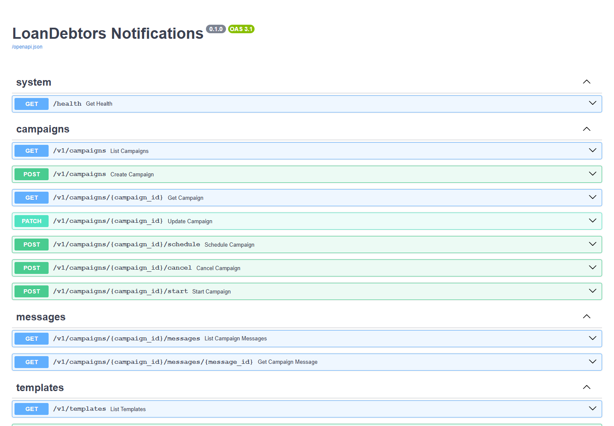
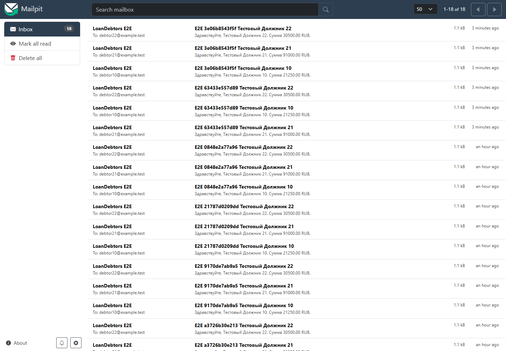
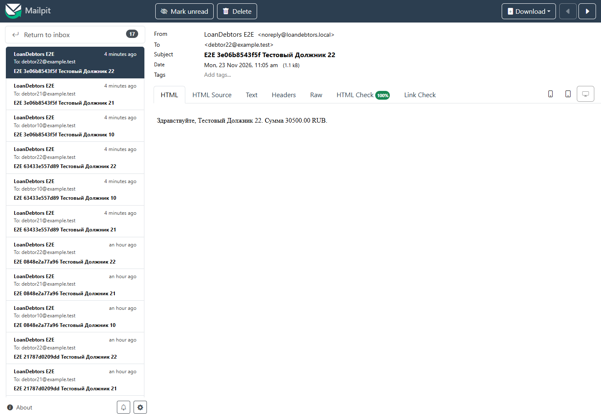
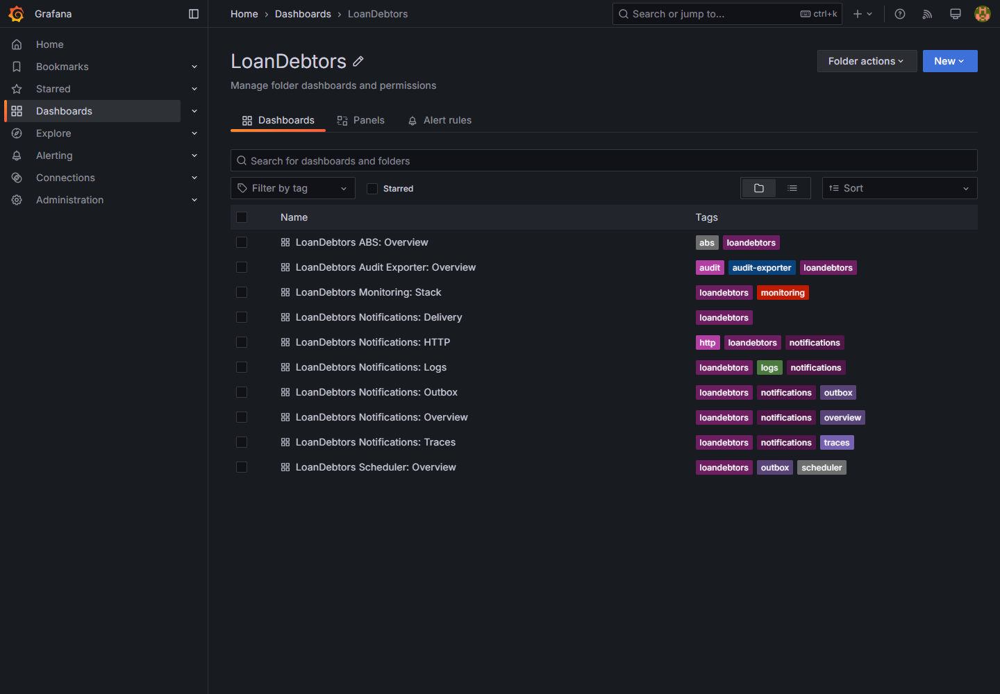
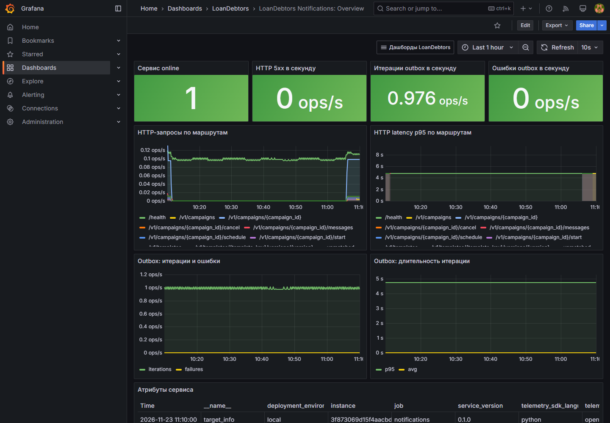
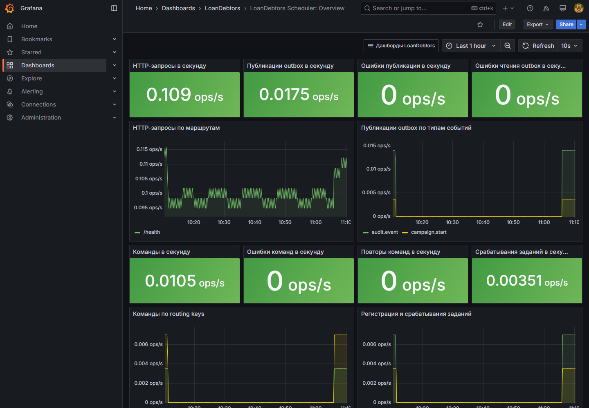
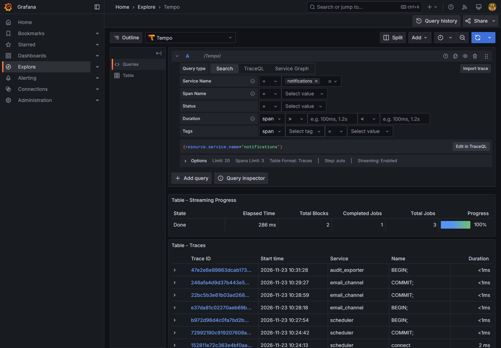
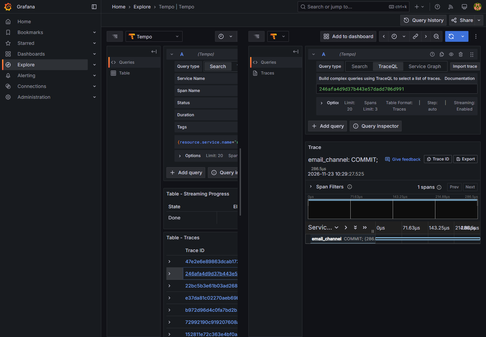
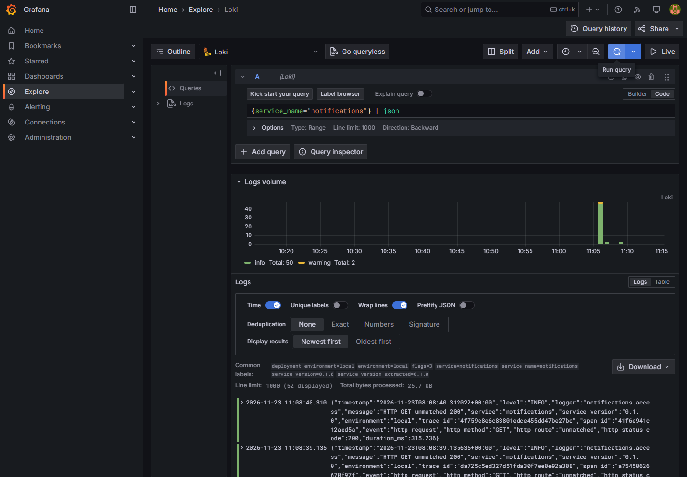

# Инструкция по использованию системы

## 1. Введение

### 1.1. Для кого эта инструкция

Инструкция предназначена для оператора кампаний, администратора канала и
дежурного, который проверяет работу системы на локальном стенде. Она описывает
типовой путь от запуска стенда до просмотра писем, журнала аудита, метрик,
трейсов и логов.

### 1.2. Роли пользователей

| Роль | Что делает |
|---|---|
| Оператор | Создает шаблоны и кампании, запускает и отменяет рассылку, смотрит статусы сообщений |
| Администратор | Настраивает SMTP-канал, email-шаблоны и выгружает журнал аудита |
| Дежурный или DevOps | Проверяет health, очереди, метрики, трейсы и логи |

### 1.3. Что описано в документе

Документ показывает, как:

- запустить стенд и проверить, что сервисы работают;
- настроить канал email и шаблоны;
- создать кампанию, запустить ее сразу или по расписанию;
- проверить статусы кампании и сообщений;
- найти письма в Mailpit;
- посмотреть метрики, трейсы и логи в Grafana;
- разобраться с типовыми проблемами.

## 2. Подготовка стенда

### 2.1. Требования

- Docker Desktop;
- `uv`;
- свободные порты из таблицы ниже;
- файл `.env` в корне репозитория.

Если `.env` еще нет, создайте его:

```bash
make env
```

### 2.2. Первый запуск

Из корня репозитория:

```bash
make install
make up-all
```

`make up-all` собирает и запускает PostgreSQL, RabbitMQ, Mailpit, OTel Collector,
Tempo, Loki, Prometheus, Grafana, заглушку АБС и четыре сервиса. Первый запуск
может занять несколько минут.

То же самое без Makefile:

```bash
docker compose up -d --build
```

### 2.3. Проверка работоспособности

Проверьте health Notifications:

```bash
curl http://localhost:8001/health
```

Ответ `200` и `"status": "ok"` означает, что сервис и его зависимости готовы.
Если вернулся `503`, смотрите раздел диагностики.

Проверить все контейнеры:

```bash
make ps
```

### 2.4. Адреса сервисов

| Что открыть | Адрес | Вход |
|---|---|---|
| Swagger Notifications | http://localhost:8001/docs | Без входа |
| Swagger Email Channel | http://localhost:8003/docs | Без входа |
| Swagger Audit Exporter | http://localhost:8004/docs | Без входа |
| Mailpit | http://localhost:8025 | Без входа |
| Grafana | http://localhost:3000 | `admin` / `admin` |
| Prometheus | http://localhost:9090 | Без входа |
| Tempo | http://localhost:3200 | Без входа |
| RabbitMQ Management | http://localhost:15672 | `loandebtors` / `loandebtors` |

Логин и пароль RabbitMQ Management задаются переменными
`RABBITMQ_DEFAULT_USER` и `RABBITMQ_DEFAULT_PASS` в `.env`. Логин и пароль
Grafana задаются переменными `GRAFANA_ADMIN_USER` и `GRAFANA_ADMIN_PASSWORD`.

Swagger Notifications показывает все доступные операции оператора.



## 3. Общий сценарий работы

1. Настройте SMTP-канал Email Channel на Mailpit.
2. Создайте логический шаблон Notifications и активируйте его версию.
3. Создайте email-шаблон с темой и текстом письма.
4. Создайте кампанию с выборкой должников.
5. Запустите кампанию сразу или поставьте ее в расписание.
6. Следите за статусом кампании и сообщений.
7. Проверьте письма в Mailpit.
8. При необходимости выгрузите журнал аудита.
9. Для диагностики откройте Grafana, RabbitMQ Management или логи контейнеров.

## 4. Пошаговые сценарии

### 4.1. Настроить Email Channel

Для локального стенда письма принимает Mailpit. Настройте канал:

```bash
curl -sS -X PUT http://localhost:8003/v1/config \
  -H 'Content-Type: application/json' \
  -d '{
    "host": "mailpit",
    "port": 1025,
    "username": "mailpit",
    "password_ref": "SMTP_PASSWORD",
    "from_address": "noreply@loandebtors.local",
    "from_name": "LoanDebtors",
    "use_starttls": false,
    "timeout_seconds": 10,
    "rate_limit_per_second": 10,
    "enabled": true
  }'
```

Проверить сохраненные настройки:

```bash
curl -sS http://localhost:8003/v1/config
```

Проверить настройки без сохранения:

```bash
curl -sS -X POST http://localhost:8003/v1/config/validate \
  -H 'Content-Type: application/json' \
  -d '{
    "host": "mailpit",
    "port": 1025,
    "username": "mailpit",
    "password_ref": "SMTP_PASSWORD",
    "from_address": "noreply@loandebtors.local",
    "from_name": "LoanDebtors",
    "use_starttls": false,
    "timeout_seconds": 10,
    "rate_limit_per_second": 10,
    "enabled": true
  }'
```

### 4.2. Создать логический шаблон

Логический шаблон описывает набор переменных, но не содержит текста письма.

```bash
curl -sS -X POST http://localhost:8001/v1/templates \
  -H 'Content-Type: application/json' \
  -d '{
    "key": "payment-reminder",
    "version": 1,
    "description": "Напоминание о просрочке",
    "required_variables": ["debtor_name", "amount", "currency"]
  }'
```

Активируйте версию:

```bash
curl -sS -X PATCH \
  http://localhost:8001/v1/templates/payment-reminder/versions/1 \
  -H 'Content-Type: application/json' \
  -d '{"status": "active"}'
```

Кампанию можно создать только с активной версией шаблона.

### 4.3. Создать email-шаблон

Email-шаблон содержит тему, HTML и текстовую часть письма. Переменные
подставляются в формате Jinja2.

```bash
curl -sS -X PUT \
  http://localhost:8003/v1/templates/payment-reminder/versions/1 \
  -H 'Content-Type: application/json' \
  -d '{
    "locale": "ru-RU",
    "subject_template": "Напоминание о просрочке, {{ debtor_name }}",
    "html_template": "<p>Здравствуйте, {{ debtor_name }}.</p><p>Сумма к погашению: {{ amount }} {{ currency }}.</p>",
    "plain_text_template": "Здравствуйте, {{ debtor_name }}. Сумма к погашению: {{ amount }} {{ currency }}.",
    "required_variables": ["debtor_name", "amount", "currency"]
  }'
```

### 4.4. Создать кампанию

Для быстрой проверки используйте выборку с просрочкой не меньше 360 дней. В
текущем фикстуре АБС это три должника.

```bash
curl -sS -X POST http://localhost:8001/v1/campaigns \
  -H 'Content-Type: application/json' \
  -d '{
    "name": "Демонстрационная кампания",
    "channel": "email",
    "template_key": "payment-reminder",
    "template_version": 1,
    "selection": {
      "criteria": {
        "min_days_overdue": "360"
      }
    }
  }'
```

В ответе будет `id` кампании и статус `draft`. Сохраните `id` для следующих
запросов.

### 4.5. Запустить кампанию сейчас

```bash
curl -sS -X POST \
  http://localhost:8001/v1/campaigns/<campaign_id>/start
```

Ответ `202` означает, что запуск принят. Дальше Notifications выгружает
должников из АБС, создает сообщения и отправляет их через Email Channel.

Проверить кампанию:

```bash
curl -sS http://localhost:8001/v1/campaigns/<campaign_id>
```

Успешная кампания проходит статусы `draft`, `running`, `completed`.

### 4.6. Запланировать кампанию

Создайте кампанию как в разделе 4.4, затем поставьте ее в расписание:

```bash
curl -sS -X POST \
  http://localhost:8001/v1/campaigns/<campaign_id>/schedule \
  -H 'Content-Type: application/json' \
  -d '{
    "schedule": {
      "kind": "one_off",
      "timezone": "Europe/Moscow",
      "run_at": "2026-12-01T10:00:00Z"
    }
  }'
```

Кампания перейдет в `scheduled`. В указанное время Scheduler отправит команду
запуска, и кампания начнет выгрузку должников.

Для повторяющегося запуска используйте `"kind": "cron"` и пятипольное выражение
в поле `cron`.

### 4.7. Отменить кампанию

```bash
curl -sS -X POST \
  http://localhost:8001/v1/campaigns/<campaign_id>/cancel
```

Отменить можно запланированную или выполняющуюся кампанию. Неотправленные
сообщения получают статус `cancelled`.

### 4.8. Проверить статусы сообщений

Список сообщений кампании:

```bash
curl -sS \
  'http://localhost:8001/v1/campaigns/<campaign_id>/messages?limit=100'
```

Одно сообщение:

```bash
curl -sS \
  http://localhost:8001/v1/campaigns/<campaign_id>/messages/<message_id>
```

В ответе видны статус, число попыток, время следующей попытки и последняя ошибка
провайдера.

### 4.9. Проверить письма в Mailpit

Откройте http://localhost:8025. В папке `Inbox` появятся письма, которые
Email Channel передал в Mailpit.



Нажмите на письмо, чтобы проверить тему, получателя, HTML и текстовую часть.



## 5. Статусы и их значение

### 5.1. Статусы кампании

| Статус | Значение |
|---|---|
| `draft` | Кампания создана, но еще не запускалась |
| `scheduled` | Кампания ждет запуска по расписанию |
| `running` | Идет выгрузка должников, создание и отправка сообщений |
| `completed` | Все сообщения обработаны |
| `cancelled` | Кампания отменена |
| `failed` | Выгрузка или запуск завершились ошибкой |

### 5.2. Статусы сообщения

| Статус | Значение |
|---|---|
| `pending` | Сообщение создано и ждет постановки в очередь |
| `queued` | Команда отправки опубликована в RabbitMQ |
| `sent` | Провайдер принял письмо |
| `failed` | Постоянная ошибка или исчерпаны попытки |
| `cancelled` | Сообщение отменено вместе с кампанией |

Статус `sent` означает, что письмо принято провайдером. Факт доставки в
почтовый ящик в учебной системе не подтверждается.

### 5.3. Статусы расписания

| Статус | Значение |
|---|---|
| `active` | Задание зарегистрировано и будет запущено |
| `paused` | Задание временно не запускается |
| `cancelled` | Задание снято |
| `completed` | Разовое задание выполнено |

## 6. Grafana: метрики

### 6.1. Вход в Grafana

Откройте http://localhost:3000 и войдите как `admin` / `admin`. Если Grafana
предлагает сменить пароль, можно нажать `Skip` для учебного стенда.

### 6.2. Папка LoanDebtors

Откройте меню `Dashboards` и папку `LoanDebtors`. В ней лежат дашборды по
сервисам.



### 6.3. Обзорные дашборды

| Дашборд | Что смотреть |
|---|---|
| `LoanDebtors Notifications: Overview` | Общее состояние Notifications, HTTP, outbox и последние логи |
| `LoanDebtors Notifications: HTTP` | Запросы по маршрутам, коды ответа и латентность |
| `LoanDebtors Notifications: Outbox` | Публикации, ошибки и длительность outbox relay |
| `LoanDebtors Notifications: Delivery` | Consumer, повторы, DLQ, размер выборки и восстановление |
| `LoanDebtors Scheduler: Overview` | Задания APScheduler, срабатывания, отмена и outbox |
| `LoanDebtors Audit Exporter: Overview` | Прием audit-событий, ошибки, DLQ и HTTP |
| `LoanDebtors ABS: Overview` | Запросы к заглушке АБС |
| `LoanDebtors Monitoring: Stack` | Состояние Prometheus, Collector и Tempo |

Обзор Notifications:



Обзор Scheduler:



### 6.4. HTTP, outbox и доставка

На дашборде `HTTP` смотрите:

- какие маршруты вызываются;
- есть ли ответы `4xx` и `5xx`;
- как меняется латентность.

На дашборде `Outbox` смотрите:

- растет ли число опубликованных записей;
- есть ли ошибки публикации;
- успевает ли relay разбирать очередь.

На дашборде `Delivery` смотрите:

- работает ли consumer сообщений;
- появляются ли повторы и сообщения в DLQ;
- как идет восстановление после сбоя.

### 6.5. Примеры запросов PromQL

Откройте `Explore`, выберите источник `Prometheus` и выполните:

```promql
target_info{job="notifications"}
```

```promql
sum by (http_route) (rate(loandebtors_notifications_http_requests_total[5m]))
```

```promql
sum(rate(loandebtors_notifications_outbox_published_total[5m]))
```

```promql
sum(rate(loandebtors_email_channel_email_sent_total[5m]))
```

```promql
sum(rate(loandebtors_audit_exporter_audit_ingested_total[5m]))
```

Если метрика пустая, проверьте, что стенд работал в выбранном диапазоне времени
и что сервис отправляет телеметрию.

## 7. Grafana: трейсы

### 7.1. Источник Tempo

Откройте `Explore`, выберите источник `Tempo`. В учебном стенде трейсы
собираются через OTel Collector и хранятся в Tempo.

### 7.2. Поиск трейса по сервису

1. В запросе Tempo выберите режим `Search`.
2. В поле `Service Name` выберите `notifications`, `scheduler`,
   `email_channel` или `audit_exporter`.
3. Нажмите `Run query`.

Появится таблица трейсов с идентификатором, временем, сервисом и длительностью.



Нажмите на идентификатор трейса, чтобы открыть водопад спанов.



### 7.3. Поиск трейса по trace_id

Если у вас есть `trace_id` из лога или audit-события:

1. Откройте `Explore` с источником `Tempo`.
2. Выберите режим `TraceQL`.
3. Введите идентификатор трейса в поле запроса.
4. Нажмите `Run query`.

### 7.4. Переход из лога в трейс

В Loki у строки лога с полем `trace_id` появляется ссылка `TraceID`. Нажмите на
нее, чтобы открыть этот трейс в Tempo.

### 7.5. Ограничения Tempo в Grafana 11.5

Grafana 11.5 не выполняет TraceQL search в панелях дашборда через backend.
Поэтому отдельные трейсы открываются в `Explore` с источником `Tempo`.
Дашборд `LoanDebtors Notifications: Traces` показывает состояние конвейера
трейсов, а не список конкретных трейсов.

## 8. Grafana: логи

### 8.1. Источник Loki

Логи сервисов пишутся в stdout и отправляются через OTel Collector в Loki.
Откройте `Explore` и выберите источник `Loki`.

### 8.2. Базовые запросы LogQL

Все логи Notifications:

```logql
{service_name="notifications"}
```

Логи с разбором JSON:

```logql
{service_name="notifications"} | json
```

Логи Scheduler:

```logql
{service_name="scheduler"} | json
```

Логи Email Channel:

```logql
{service_name="email_channel"} | json
```

Логи Audit Exporter:

```logql
{service_name="audit_exporter"} | json
```

### 8.3. Поиск ошибок

```logql
{service_name="notifications"} | json | level="ERROR"
```

```logql
{service_name="email_channel"} | json | level="ERROR"
```

```logql
{service_name="scheduler"} | json | level="ERROR"
```

### 8.4. Поиск по correlation_id и trace_id

По идентификатору корреляции:

```logql
{service_name="notifications"} | json | correlation_id="<correlation_id>"
```

По идентификатору трейса:

```logql
{service_name="notifications"} | json | trace_id="<trace_id>"
```

Скриншот показывает список логов Notifications, полученный запросом
`{service_name="notifications"} | json`.



### 8.5. Связь логов с трейсами

В JSON-логе есть поля `trace_id` и `span_id`. Если открыть строку лога в
Grafana, появится ссылка `TraceID`. Она ведет в Tempo к тому же запросу,
который породил лог.

## 9. Диагностика проблем

### 9.1. Адреса недоступны

Проверьте контейнеры:

```bash
make ps
```

Если список пуст, стенд остановлен. Запустите его:

```bash
make up-all
```

Если Docker Desktop не запущен, запустите его и повторите `make up-all`.

### 9.2. Сервис отвечает 503

`503` означает, что сервис не видит обязательную зависимость, например
PostgreSQL или RabbitMQ. Проверьте health:

```bash
curl -i http://localhost:8001/health
```

В ответе будет список проверок `database`, `rabbitmq`, `outbox_relay` и других.
Посмотрите логи сервиса:

```bash
docker compose logs -f notifications
```

### 9.3. Письма не приходят

1. Проверьте, что кампания в статусе `completed`.
2. Проверьте сообщения:
   ```bash
   curl -sS 'http://localhost:8001/v1/campaigns/<campaign_id>/messages?limit=100'
   ```
3. Откройте Mailpit: http://localhost:8025.
4. Проверьте health Email Channel: http://localhost:8003/health.
5. Посмотрите логи Email Channel:
   ```bash
   docker compose logs -f email-channel
   ```

### 9.4. Кампания завершилась ошибкой

Откройте кампанию:

```bash
curl -sS http://localhost:8001/v1/campaigns/<campaign_id>
```

Поле `failure_reason` содержит причину. Частые причины:

- АБС недоступна;
- выборка неполная;
- версия шаблона не активна;
- неверные параметры выборки.

Логи Notifications покажут подробности:

```bash
docker compose logs -f notifications | grep <campaign_id>
```

### 9.5. Сообщения зависли

Если сообщения долго остаются в `queued`, проверьте:

1. Работает ли Email Channel.
2. Нет ли ошибок в его логах.
3. Есть ли сообщения в DLQ в RabbitMQ Management.

Откройте http://localhost:15672, войдите как `loandebtors` /
`loandebtors` и посмотрите очереди `email.commands`, `notification.results` и
их `*.dlq`.

### 9.6. Проверка очередей и DLQ

В RabbitMQ Management откройте `Queues and Streams`. Нормальная картина после
завершения кампании:

- `email.commands` пуста;
- `notification.results` пуста;
- `audit.events` пуста;
- очереди `*.dlq` пусты.

Если в DLQ есть сообщения, посмотрите их тело и заголовки. Для Audit Exporter
есть команда повторной публикации:

```bash
make redrive-audit-dlq LIMIT=10
```

## 10. Остановка и очистка

### 10.1. Остановка стенда

```bash
make down
```

Или:

```bash
docker compose down
```

### 10.2. Полная очистка данных

Команда ниже удаляет контейнеры и тома с PostgreSQL, Grafana, Prometheus,
Tempo и Loki. Используйте ее только если готовы потерять данные стенда.

```bash
docker compose down -v
```

## 11. Полезные команды

| Команда | Назначение |
|---|---|
| `make up-all` | Собрать и запустить инфраструктуру и сервисы |
| `make up` | Запустить только инфраструктуру, Мониторинг и заглушку АБС |
| `make down` | Остановить стенд |
| `make ps` | Показать контейнеры |
| `make logs` | Смотреть логи всех контейнеров |
| `make smoke` | Проверить health Notifications |
| `make smoke-email-channel` | Проверить health Email Channel |
| `make smoke-audit-exporter` | Проверить health Audit Exporter |
| `make smoke-scheduler` | Проверить health Scheduler |
| `make e2e` | Запустить сквозные сценарии |
| `make test-all` | Запустить все тесты, включая интеграционные |
| `make contracts` | Проверить OpenAPI и AsyncAPI |

## 12. Ограничения учебного стенда

- Один экземпляр каждого сервиса и один экземпляр PostgreSQL и RabbitMQ.
- Аутентификация и авторизация API не выполняются.
- Mailpit принимает письма локально и не является реальным почтовым
  провайдером.
- Факт доставки письма в почтовый ящик не подтверждается.
- Журнал аудита append-only: записи нельзя изменить или удалить.
- Заглушка АБС содержит 24 тестовых должника и не является реальной АБС.
- Промышленная отказоустойчивость, SLA и резервирование не предусмотрены.
