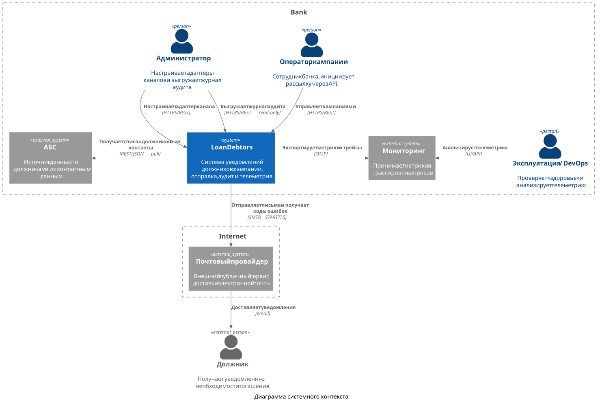

# 3. Контекст и границы

Раздел разграничивает LoanDebtors (систему уведомлений должников) и её окружение. Требования
и функции описаны в разделе [1-introduction-and-goals](1-introduction-and-goals.md),
ограничения в разделе [2-constraints](2-constraints.md).

## 3.1 Бизнес-контекст

В границу системы LoanDebtors входят управление кампаниями, подготовка и отправка уведомлений,
очередь и повторные попытки, журнал аудита и телеметрия. Вне границы находятся АБС,
почтовый провайдер, Мониторинг (OTel-коллектор или бэкенд) и будущие каналы SMS и мессенджеров.

В таблице вход означает данные, которые Система получает от партнёра. Выход
означает данные, которые Система передаёт партнёру.

| Партнёр            | Описание                                                                 | Вход                                                                        | Выход                                                                           |
|--------------------|--------------------------------------------------------------------------|-----------------------------------------------------------------------------|---------------------------------------------------------------------------------|
| АБС                | Корпоративная система, источник истины по должникам и контактным данным. | Портфель должников и контактные данные.                                     | Запросы на выгрузку портфеля.                                                   |
| Оператор кампании  | Сотрудник банка, который инициирует рассылку через HTTP API.            | Параметры кампании, шаблон уведомления, выборка должников, команда запуска. | Статус кампании и результаты отправки.                                          |
| Должник            | Физическое лицо, получатель уведомления.                                 | Прямого входа нет.                                                          | Уведомление о необходимости погашения, доставляемое через почтового провайдера. |
| Почтовый провайдер | Внешний публичный сервис доставки электронной почты.                     | Коды временных и постоянных отказов, результат отправки.                    | Письма для доставки должникам.                                                  |
| Администратор      | Сотрудник, настраивающий адаптеры каналов и выгружающий журнал аудита.   | Параметры адаптера канала, запрос на выгрузку журнала аудита.               | Статус настройки адаптера, записи журнала аудита.                               |

Доставку писем выполняет почтовый провайдер. Система не взаимодействует с почтовыми
серверами получателей напрямую.

SMS и мессенджеры появятся при расширении. В первой версии они не являются
активными партнёрами и показаны только как точки расширения.

Роли из раздела 1, у которых нет прямого интерфейса с Системой, остаются
заинтересованными сторонами и не дублируются в таблице.

## 3.2 Технический контекст

Таблица фиксирует каналы, протоколы и форматы обмена. Для каждого канала указан
инициатор взаимодействия.

| Канал                      | Протокол / формат                  | Взаимодействие                                                                                                                                                                           |
|----------------------------|------------------------------------|------------------------------------------------------------------------------------------------------------------------------------------------------------------------------------------|
| Интеграция с АБС           | HTTPS, REST, JSON                  | Система инициирует запрос методом pull и получает портфель должников и контактные данные. АБС не изменяется, ответ синхронный. Ограничение: TC-2, TC-8. Контракт: `source/contracts/openapi/abs.yaml`. На локальном стенде внешнюю АБС имитирует заглушка `abs`. |
| Отправка электронной почты | SMTP, MIME, STARTTLS               | Система инициирует отправку, соблюдает лимит провайдера и обрабатывает коды временных и постоянных отказов. Доставка выполняется провайдером асинхронно. Ограничения: TC-3, TC-4.        |
| Управление кампаниями      | HTTPS, REST, JSON, OpenAPI         | Оператор создаёт, запускает и останавливает кампанию. Аутентификация и авторизация не выполняются, доступ только из доверенного контура. Ограничения: OC-2, OC-3.                        |
| Настройка адаптера канала  | HTTPS, REST, JSON, OpenAPI         | Администратор через API настраивает конкретный адаптер канала, например, почтовый. Доступ только из доверенного контура, аутентификация и авторизация не выполняются. Ограничение: OC-2. |
| Выгрузка журнала аудита    | HTTPS, REST, JSON, read-only       | Администратор выгружает записи журнала аудита. Изменение и удаление записей запрещены. Ограничение: TC-7.                                                                                |
| Экспорт телеметрии         | OTLP через gRPC или HTTP, protobuf | Система экспортирует метрики, трейсы и логи в Мониторинг. На учебном стенде Мониторинг реализуют OTel Collector, Grafana Tempo, Loki, Prometheus и Grafana. Экспорт асинхронный. Ограничение: TC-5. |
| Проверка работоспособности | HTTPS, JSON                        | Эксплуатация или DevOps проверяет состояние Системы. Доступ только из доверенного контура. Ограничение: OC-2.                                                                            |

Эксплуатация или DevOps также анализирует метрики и трейсы в Мониторинге через его
UI или API. Этот канал не проходит через Систему.

На учебном стенде Мониторинг состоит из OTel Collector, Grafana Tempo, Loki,
Prometheus и Grafana. Collector принимает OTLP, Tempo хранит трейсы, Loki
хранит логи, Prometheus хранит метрики, Grafana показывает все виды данных.
Конкретный бэкенд Мониторинга не влияет на контракт Системы: сервисы всегда
экспортируют OTLP.

СУБД и очередь сообщений находятся внутри границы Системы и не являются внешними
каналами.

Заглушка `abs` не входит в границу Системы. Она реализует контракт внешней АБС
на локальном стенде и не заменяет реальную систему в продуктовой среде.

Специальных аппаратных требований нет, используется учебный стенд. Данные тестовые
или обезличенные (OC-4).

При подключении SMS или мессенджера добавляется отдельный канал и адаптер, доменное
ядро не меняется.
