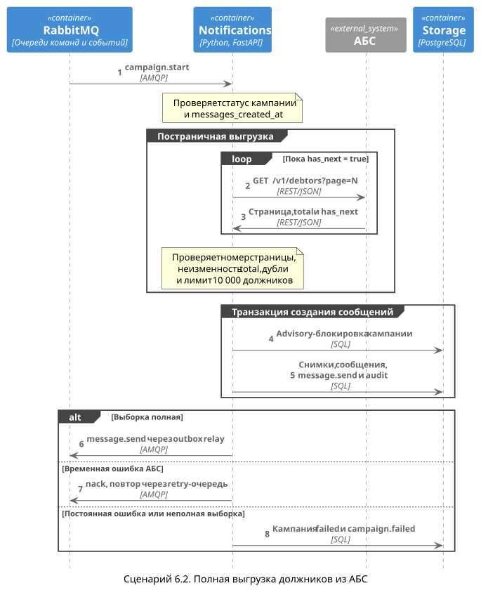
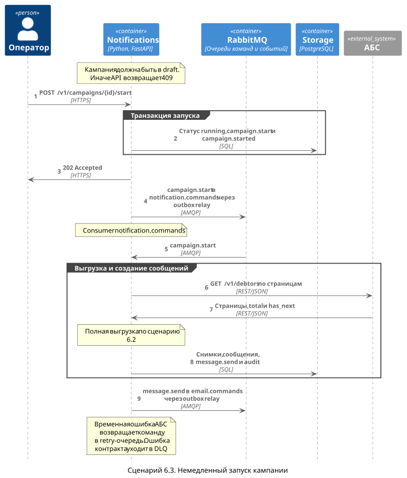
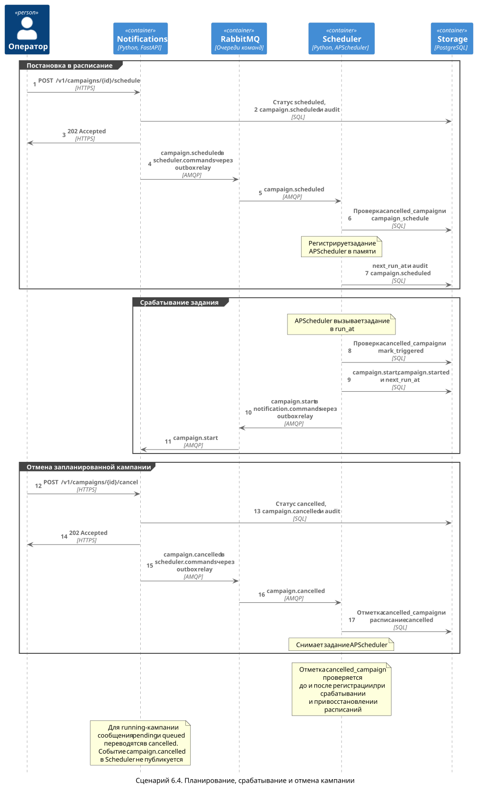
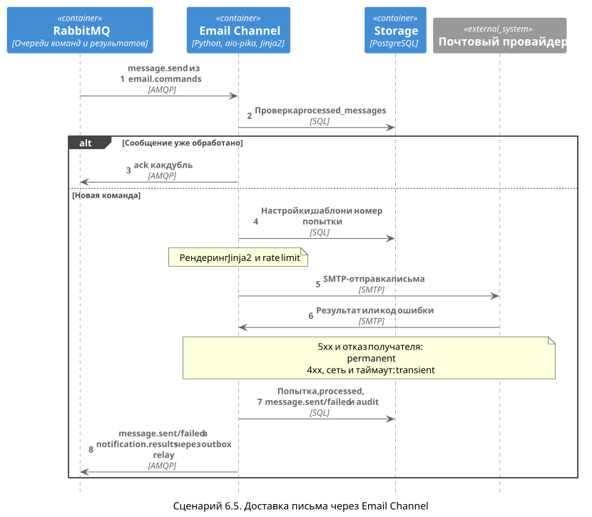
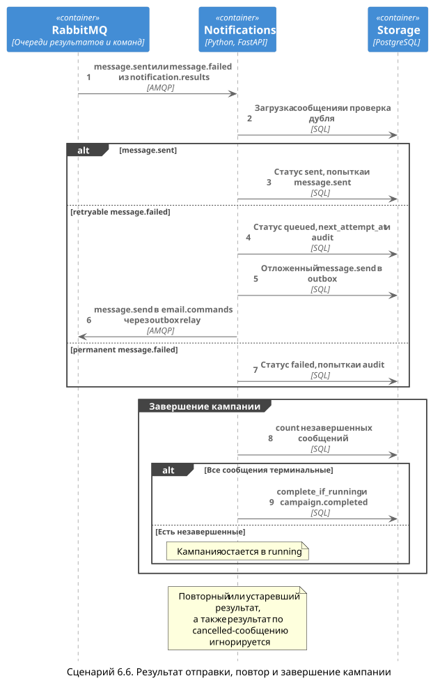
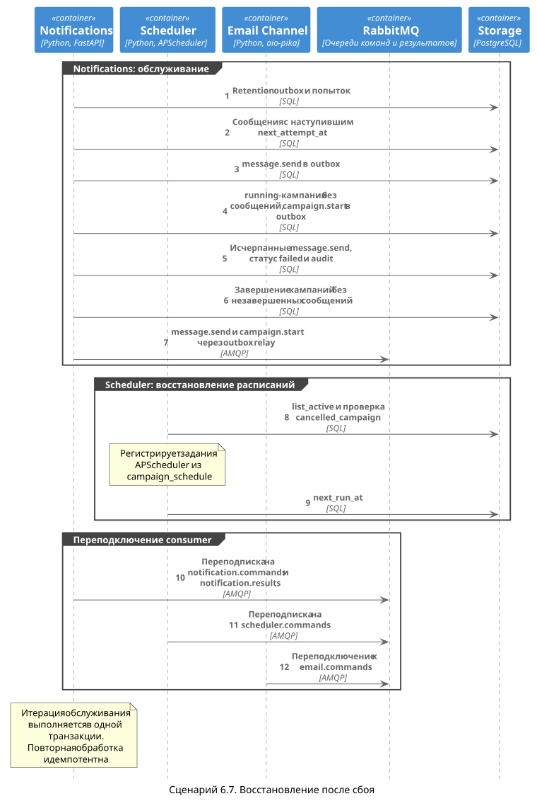
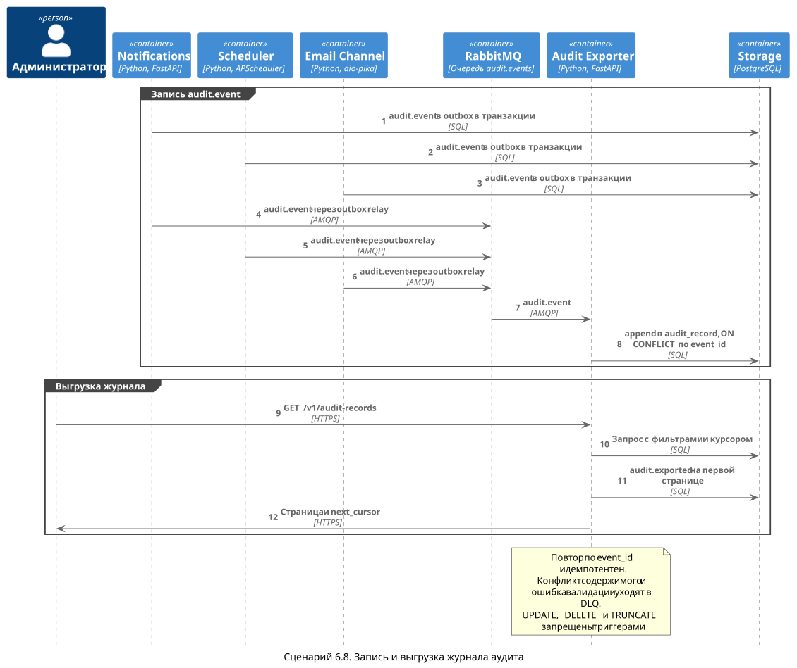

# 6. Runtime View

Раздел описывает основные сценарии выполнения Системы: участников,
последовательность шагов, изменения состояния и альтернативные ветки. Основание:
разделы [3-context-and-scope](3-context-and-scope.md),
[5-building-block-view](5-building-block-view.md) и
[8-cross-cutting-concepts](8-cross-cutting-concepts.md). Статусы, идентификаторы
и структура событий приведены в разделе 8.2.

Публикация команд и событий между сервисами идёт через транзакционный outbox.
Сервис записывает событие в свою таблицу outbox в одной транзакции с изменением
состояния. Фоновый outbox relay выбирает готовые записи, публикует их в
RabbitMQ с publisher confirms и при ошибке повторяет публикацию с
экспоненциальной задержкой. Неопубликованные записи сохраняются в PostgreSQL и
переживают перезапуск сервиса.

## 6.1 Перечень сценариев

| №   | Сценарий                                | Участники                                                          | Основной результат                                             |
|-----|-----------------------------------------|--------------------------------------------------------------------|----------------------------------------------------------------|
| 6.2 | Полная выгрузка должников из АБС        | Notifications, АБС                                                 | снимки должников, сообщения, команды `message.send`            |
| 6.3 | Немедленный запуск кампании             | Оператор, Notifications, RabbitMQ, АБС                             | кампания в `running`, сообщения в очереди                      |
| 6.4 | Планирование, срабатывание и отмена     | Оператор, Notifications, Scheduler, RabbitMQ                       | задание APScheduler, `campaign.start`, снятие задания          |
| 6.5 | Доставка письма через Email Channel     | Email Channel, почтовый провайдер, RabbitMQ                        | письмо отправлено, попытка и результат доставки                |
| 6.6 | Результат отправки, повтор и завершение | Notifications, RabbitMQ, PostgreSQL                                | статус сообщения, повтор или `completed` кампании              |
| 6.7 | Восстановление после сбоя               | Notifications, Scheduler, Email Channel, PostgreSQL, RabbitMQ      | восстановленные задания, сообщения и кампании                  |
| 6.8 | Запись и выгрузка журнала аудита        | Notifications, Scheduler, Email Channel, Audit Exporter, Администратор | append-only журнал, событие `audit.exported`               |

Сценарии 6.2 и 6.3 образуют общий путь запуска кампании. Сценарий 6.2 является
подшагом и для немедленного, и для планового запуска.

## 6.2 Полная выгрузка должников из АБС

Участники: Notifications, АБС. Сценарий выполняется consumer `campaign.start`.
До выгрузки кампания находится в `running` при немедленном запуске или в
`scheduled` при плановом запуске. На локальном стенде роль АБС выполняет
заглушка `abs`.

1. Consumer загружает кампанию по `campaign_id`. Если кампании нет, обработка
   завершается без ошибки. Если кампания в терминальном статусе или
   `messages_created_at` уже заполнен, команда считается обработанной.
2. Notifications отображает `DebtorSelection.criteria` в параметры АБС:
   `min_days_overdue`, `max_days_overdue`, `channel`. Неизвестные ключи
   игнорируются с предупреждением. Если `min_days_overdue` больше
   `max_days_overdue`, выгрузка не начинается.
3. Notifications запрашивает страницу 1 с размером `DEBTOR_PAGE_SIZE`. Нумерация
   страниц начинается с 1.
4. По первой странице запоминается `total` как `selection_expected`. Если
   `total` превышает `DEBTOR_SELECTION_MAX_TOTAL`, выборка отклоняется.
5. Пока `has_next = true`, запрашивается следующая страница. Для каждой страницы
   проверяются номер страницы, неизменность `total`, отсутствие дублей
   `debtor_id` и непустой список при `has_next = true`.
6. После `has_next = false` число полученных должников сравнивается с
   `selection_expected`. Расхождение означает неполную выборку.
7. Notifications открывает транзакцию и берет транзакционную advisory-блокировку
   по `campaign_id`. Если блокировку держит другой consumer, возникает временная
   ошибка и команда возвращается в очередь.
8. Внутри транзакции кампания перечитывается. Если она уже терминальная или
   сообщения уже созданы, транзакция завершается без изменений. Иначе кампания
   переводится в `running`.
9. Для каждого должника выбирается основной контакт канала, при его отсутствии
   первый контакт. Должники без контакта канала пропускаются. Переменные
   шаблона собираются из данных должника: имя, сумма задолженности, валюта,
   номер договора, дата погашения и дни просрочки.
10. В одной транзакции заменяются снимки должников, создаются сообщения,
    команды `message.send` в outbox и audit-события `message.queued`. Кампания
    получает `selected_debtors`, `selection_expected`, `selection_completed_at`
    и `messages_created_at`.
11. Если сообщений не создано, кампания сразу переводится в `completed`, а в
    аудит пишется `campaign.completed` с причиной `no_recipients`. Если статус
    изменился на `running`, пишется `campaign.started`.
12. После коммита outbox relay публикует команды `message.send` в
    `email.commands`. Метрики фиксируют число выгруженных должников и созданных
    сообщений.

Альтернативные ветки:

- АБС отвечает таймаутом или 5xx. Адаптер выполняет ограниченное число
  внутренних повторов, затем возвращает временную ошибку. Consumer отклоняет
  сообщение без повторной постановки, RabbitMQ возвращает его через
  retry-очередь. Статус кампании не меняется.
- АБС отвечает 4xx или нарушает контракт. Кампания переходит в `failed` с
  причиной, пишется `campaign.failed`. Частичный снимок не сохраняется.
- Выборка неполная или противоречивая: изменился `total`, обнаружен дубль,
  номер страницы не совпал, превышен лимит. Кампания переходит в `failed`.
- Команда доставлена повторно. Заполненный `messages_created_at` или
  терминальный статус останавливают обработку, дубли сообщений не создаются.
- Другой consumer уже обрабатывает кампанию. Текущая попытка возвращается в
  retry-очередь, результат фиксирует только один consumer.
- В выборке нет должников. Создается кампания без сообщений со статусом
  `completed` и audit-событием с причиной `no_recipients`.
- Ошибка PostgreSQL во время транзакции. Транзакция откатывается, команда
  возвращается в retry-очередь.

## 6.3 Немедленный запуск кампании

Участники: Оператор, Notifications, RabbitMQ, АБС. Предусловие: кампания создана
в `draft`, выбранная версия логического шаблона активна.

1. Оператор вызывает `POST /v1/campaigns/{campaign_id}/start`.
2. Notifications проверяет, что кампания в `draft`. Иначе возвращается 409.
3. Кампания переводится в `running`, заполняется `started_at`. В той же
   транзакции в `notification.outbox` пишутся `campaign.start` и audit-событие
   `campaign.started`. API возвращает 202.
4. Outbox relay публикует `campaign.start` в `notification.commands` с
   correlation id и trace context.
5. Consumer `notification.commands` разбирает команду, извлекает trace context и
   вызывает сценарий запуска.
6. Notifications выполняет полную выгрузку АБС по сценарию 6.2.
7. В одной транзакции сохраняются снимки, сообщения, audit-события
   `message.queued` и команды `message.send` в outbox.
8. Outbox relay публикует `message.send` в `email.commands`.

Correlation id и trace context передаются в заголовках событий и HTTP-вызовов.
Трейс охватывает вызовы АБС, публикацию команд, отправку письма и ответ
почтового провайдера.

Альтернативные ветки:

- Кампания не в `draft`: возвращается 409, outbox не меняется.
- Команда `campaign.start` доставлена повторно: `messages_created_at` уже
  заполнен, повтор пропускается.
- Кампания отменена до обработки команды: consumer видит терминальный статус и
  не создает сообщения.
- Тело команды не соответствует контракту: сообщение отправляется в
  `notification.commands.dlq`, исходное сообщение подтверждается.
- Временная ошибка АБС или занятая advisory-блокировка: сообщение возвращается
  в retry-очередь. После исчерпания `RABBITMQ_RETRY_MAX_ATTEMPTS` оно попадает
  в DLQ.
- RabbitMQ недоступна: записи outbox остаются в PostgreSQL, relay повторяет
  публикацию с экспоненциальной задержкой. Исчерпание попыток публикации
  `message.send` обрабатывает обслуживание по сценарию 6.7.

## 6.4 Планирование, срабатывание и отмена кампании

Участники: Оператор, Notifications, Scheduler, RabbitMQ. Предусловие: кампания
создана в `draft`.

**Постановка в расписание.**

1. Оператор вызывает `POST /v1/campaigns/{campaign_id}/schedule` с правилом
   `one_off` или `cron`.
2. Notifications проверяет статус `draft` и правило запуска. Для `one_off`
   требуется `run_at` с часовым поясом в будущем. Для `cron` требуются
   пятипольное выражение и часовой пояс IANA. Ошибка статуса возвращает 409,
   ошибка правила 422.
3. Кампания переходит в `scheduled`, заполняется `scheduled_at`. В одной
   транзакции пишутся `campaign.scheduled` в outbox и одноименное audit-событие.
4. Outbox relay публикует `campaign.scheduled` в `scheduler.commands`.
5. Scheduler проверяет тело команды и правило через APScheduler. Разовый запуск
   старше `SCHEDULE_MISFIRE_GRACE_SECONDS` отклоняется, команда уходит в DLQ.
6. Scheduler проверяет отметку об отмене кампании. Если отмена уже обработана,
   расписание не создается.
7. Scheduler создает или обновляет `scheduler.campaign_schedule` со статусом
   `active` и пишет audit-событие `campaign.scheduled` в свой outbox. Коммит
   выполняется до регистрации задания.
8. Scheduler регистрирует задание APScheduler в памяти. Идентификатор задания
   равен `campaign_id`, задание заменяет предыдущее, допускает один экземпляр,
   использует coalesce и misfire grace.
9. После регистрации Scheduler повторно проверяет отметку об отмене. Если
   отмена пришла во время регистрации, расписание переводится в `cancelled`,
   пишется audit-событие, задание снимается. Иначе сохраняется `next_run_at`.

**Срабатывание задания.**

1. APScheduler вызывает задание в плановое время.
2. Scheduler открывает транзакцию и проверяет отметку об отмене. Если отмена
   есть, активное расписание переводится в `cancelled`, пишется audit-событие,
   задание снимается, `campaign.start` не публикуется.
3. Если расписание отсутствует или не активно, задание снимается.
4. Scheduler фиксирует срабатывание: `last_triggered_at`, для `one_off` статус
   `completed`, для `cron` следующий `next_run_at`.
5. В той же транзакции в outbox пишутся `campaign.start` и audit-событие
   `campaign.started` с `scheduled_for`.
6. Outbox relay публикует `campaign.start` в `notification.commands`.
7. Notifications выполняет сценарий 6.2.

**Отмена кампании.**

1. Оператор вызывает `POST /v1/campaigns/{campaign_id}/cancel`.
2. Notifications разрешает отмену только для `scheduled` и `running`. Для
   `draft`, `completed`, `cancelled` и `failed` возвращается 409.
3. Для кампании в `scheduled` статус меняется на `cancelled`, заполняются
   `cancelled_at` и `finished_at`. В outbox пишется `campaign.cancelled`, в
   аудит пишется `campaign.cancelled`.
4. Scheduler сохраняет отметку об отмене в `scheduler.cancelled_campaign`,
   переводит найденное расписание в `cancelled`, снимает задание и пишет
   audit-событие. Если расписания еще нет, отметка сохраняется, чтобы более
   поздняя регистрация не создала задание.
5. Для кампании в `running` Notifications переводит неотправленные сообщения из
   `pending` и `queued` в `cancelled`, заполняет `cancelled_at` и `finished_at`
   и пишет `campaign.cancelled` со счетчиком отмененных сообщений. Событие
   `campaign.cancelled` в Scheduler не публикуется: отмена сообщений
   выполняется внутри Notifications.
6. Результаты отправки по отмененным сообщениям игнорируются при обработке по
   сценарию 6.6.

**Согласование порядка событий.**

- Если `campaign.cancelled` обработан раньше `campaign.scheduled`, отметка в
  `scheduler.cancelled_campaign` не дает создать задание. Постановка в
  расписание проверяет отметку до создания расписания и после регистрации
  задания.
- Срабатывание задания и восстановление расписаний также проверяют отметку,
  поэтому отмененная кампания не запускается после перезапуска Scheduler.
- Повторная отмена идемпотентна: отметка сохраняется один раз, audit-событие
  пишется только при фактической смене статуса расписания.

Альтернативные ветки:

- Повторная `campaign.scheduled` для той же кампании обновляет существующее
  расписание и заменяет задание.
- `campaign.cancelled` пришел раньше `campaign.scheduled`: создается только
  отметка об отмене, задание не регистрируется.
- Отмена совпала со срабатыванием. Если отмена уже закоммичена,
  Notifications видит терминальный статус и не создает сообщения. Если
  Scheduler уже обработал отметку об отмене, `campaign.start` не публикуется.
  Если команда отмены еще в пути, кампания может успеть перейти в `running`;
  последующая отмена переводит неотправленные сообщения в `cancelled`.
- Scheduler недоступен или команда исчерпала повторы и попала в DLQ. Кампания
  остается в `scheduled` в Notifications. Для запуска требуется повторная
  публикация команды из DLQ или пересоздание кампании.
- Для `cron` задание остается активным после срабатывания. Повторный
  `campaign.start` для завершенной или отмененной кампании игнорируется, потому
  что Notifications не перезапускает кампанию в терминальном статусе. Новая
  рассылка оформляется новой кампанией.

## 6.5 Доставка письма через Email Channel

Участники: Email Channel, почтовый провайдер, RabbitMQ. Предусловие:
администратор настроил SMTP-адаптер, а для ключа и версии логического шаблона
существует email-вариант. На локальном стенде роль провайдера выполняет Mailpit.

1. Email Channel получает `message.send` из `email.commands` и проверяет тело по
   контракту AsyncAPI. Ошибка валидации отправляет сообщение в
   `email.commands.dlq`.
2. Проверяется идемпотентность по `message_id` в
   `email_channel.processed_messages`. Уже обработанное сообщение
   подтверждается как дубль, повторная отправка не выполняется.
3. Email Channel читает настройки канала, email-шаблон по `template_key`,
   `template_version` и локали и вычисляет номер попытки.
4. Проверяются настройки и шаблон. Отсутствие настроек, выключенный канал или
   отсутствующий шаблон дают постоянную ошибку.
5. Шаблон рендерится в тему, HTML и текстовую часть. Недостающие обязательные
   переменные дают постоянную ошибку `template_error`.
6. Секрет SMTP читается по `password_ref`. Отсутствие секрета дает постоянную
   ошибку `secret_not_found`.
7. Отправка проходит через общий ограничитель скорости. Письмо отправляется
   MIME-сообщением по SMTP с таймаутом и при необходимости STARTTLS.
8. Результат классифицируется: отказ получателя и ответ 5xx считаются
   постоянными, ответ 4xx, сетевая ошибка и таймаут временными.
9. В одной транзакции фиксируется попытка отправки. Для терминального исхода
   сообщение помечается обработанным. В outbox пишется `message.sent` или
   `message.failed`, в аудит пишется одноименное событие.
10. Outbox relay публикует результат в `notification.results`.

Альтернативные ветки:

- Повторная доставка `message.send` после терминального исхода: сообщение
  подтверждается как дубль, результат повторно не публикуется.
- Временная ошибка: результат `message.failed` с `retryable = true`,
  обработанным сообщение не помечается. Notifications планирует повтор.
- Постоянная ошибка: результат `message.failed` с `retryable = false`,
  сообщение помечается обработанным.
- Исключение при обработке команды: сообщение возвращается в retry-очередь.
  После исчерпания повторов Email Channel фиксирует постоянный отказ как
  `message.failed`, затем отправляет исходное сообщение в DLQ.
- Два consumer обрабатывают одно сообщение: вставка в
  `processed_messages` выполняется с `ON CONFLICT DO NOTHING`, результат
  фиксирует только один из них.

## 6.6 Результат отправки, повтор и завершение кампании

Участники: Notifications, RabbitMQ, PostgreSQL.

1. Consumer `notification.results` разбирает `message.sent` или `message.failed`.
   Ошибка разбора отправляет сообщение в `notification.results.dlq`.
2. Notifications находит сообщение и проверяет, что оно принадлежит указанной
   кампании.
3. Сообщение в статусе `sent`, `failed` или `cancelled` игнорируется. Событие с
   номером попытки не больше `attempt_count` считается устаревшим и тоже
   игнорируется.
4. Для `message.sent` сообщение переходит в `sent`, заполняется `sent_at`.
   Записывается попытка с результатом `sent`, в аудит пишется `message.sent`.
5. Для `message.failed` рассчитывается время повтора. Повтор возможен, если
   ошибка временная и номер попытки меньше `MESSAGE_MAX_ATTEMPTS`. Задержка
   равна `MESSAGE_RETRY_BASE_SECONDS * 2^(attempt_number - 1)` и ограничена
   `MESSAGE_RETRY_MAX_SECONDS`.
6. При повторе сообщение возвращается в `queued`, заполняется `next_attempt_at`,
   записывается попытка и audit-событие `message.failed` с признаком повтора.
   В outbox пишется отложенный `message.send` с `available_at` из
   `next_attempt_at`.
7. Без повтора сообщение переходит в `failed`, заполняется `failed_at`.
   Записывается попытка и audit-событие `message.failed`.
8. После коммита результата Notifications считает незавершенные сообщения
   кампании. Если их нет, выполняется атомарный перевод `running` в
   `completed`. В аудит пишется `campaign.completed` со счетчиками `sent`,
   `failed` и `cancelled`.
9. Outbox relay публикует отложенные `message.send` в `email.commands` в
   назначенное время.

Альтернативные ветки:

- Повторная доставка результата игнорируется по статусу сообщения и номеру
  попытки.
- Результат по отмененному сообщению игнорируется.
- Постоянная ошибка или исчерпание `MESSAGE_MAX_ATTEMPTS` переводят сообщение в
  `failed`. Кампания завершается, когда все сообщения терминальные.
- Два последних результата приходят одновременно. Условный `UPDATE` в
  `complete_if_running` выигрывает только одна транзакция, дубль
  `campaign.completed` не создается.
- Кампания отменена. `complete_if_running` не меняет статус, событие
  `campaign.completed` не пишется.
- Ошибка PostgreSQL. Сообщение возвращается в retry-очередь, результат
  обрабатывается повторно.

## 6.7 Восстановление после сбоя

Участники: Notifications, Scheduler, Email Channel, PostgreSQL, RabbitMQ.

Notifications при старте и далее с интервалом `MAINTENANCE_INTERVAL_SECONDS`
выполняет одну итерацию обслуживания в транзакции:

1. Удаляет опубликованные записи outbox и попытки отправки старше
   `RETENTION_DAYS`.
2. Находит сообщения в `queued` с наступившим `next_attempt_at`, повторно
   ставит `message.send` в outbox и очищает `next_attempt_at`.
3. Находит кампании в `running` без созданных сообщений, у которых
   `started_at` старше `RECOVERY_GRACE_SECONDS`, и повторно ставит
   `campaign.start` в outbox.
4. Находит команды `message.send` в outbox с исчерпанным
   `OUTBOX_MAX_ATTEMPTS`. Сообщение переводится в `failed` с кодом
   `outbox_publish_exhausted`, пишется `message.failed`, запись outbox
   помечается окончательно неуспешной.
5. Находит кампании в `running`, у которых все сообщения терминальные, и
   переводит их в `completed` с audit-событием и счетчиками. Причина в
   audit-событии: `recovery`.
6. Фиксирует транзакцию и обновляет метрики обслуживания.

Восстановление сервисов после перезапуска:

- Scheduler регистрирует все расписания в статусе `active` из
  `scheduler.campaign_schedule`. Отмененные кампании пропускаются по отметке в
  `scheduler.cancelled_campaign`. Ошибка одного расписания не останавливает
  восстановление остальных.
- Задания APScheduler хранятся в памяти, поэтому после перезапуска Scheduler
  восстанавливает их из PostgreSQL.
- Notifications и Scheduler переподписываются на свои очереди после потери
  соединения. Email Channel переподключается к `email.commands`.
- Outbox relay повторяет публикацию с экспоненциальной задержкой. Записи
  outbox не теряются при перезапуске.
- Повторная обработка защищена идемпотентностью: `campaign.start` проверяет
  `messages_created_at`, `message.send` проверяется по `message_id`, результаты
  проверяются по статусу и номеру попытки.

Альтернативные ветки:

- Кампания отменена: обслуживание не возвращает ее в `running` и не запускает
  повторно.
- Сообщение уже терминальное: повторная постановка не выполняется.
- Публикация `message.send` исчерпала попытки: сообщение становится `failed`,
  остальные сообщения кампании продолжают обработку.
- PostgreSQL или RabbitMQ недоступны: итерация завершается ошибкой, health
  фиксирует ошибку или отставание обслуживания, следующая итерация повторяет
  работу.
- Retention не затрагивает журнал аудита: журнал append-only и хранится в
  схеме `audit`.

## 6.8 Запись и выгрузка журнала аудита

Участники: Notifications, Scheduler, Email Channel, Audit Exporter,
Администратор.

1. Сервис в транзакции изменения состояния пишет `audit.event` в свой outbox.
   Например, Notifications пишет `campaign.created` и `message.queued`,
   Scheduler пишет `campaign.scheduled`, Email Channel пишет `message.sent`.
   Одно действие может быть зафиксировано несколькими сервисами на разных
   этапах, например `campaign.started` от Scheduler и от Notifications.
   События различаются полем `service` и составом `details`.
2. Outbox relay публикует `audit.event` в `audit.events`.
3. Audit Exporter проверяет обязательные поля: `occurred_at` с часовым поясом,
   непустые `service`, `entity_type`, `entity_id`, `correlation_id` и строковые
   значения в `details`. Ошибка валидации отправляет событие в
   `audit.events.dlq`.
4. Audit Exporter вставляет запись в `audit.audit_record` с
   `ON CONFLICT DO NOTHING` по `event_id`. Повторная доставка того же события с
   тем же содержимым подтверждается без создания дубля.
5. Если `event_id` уже записан с другим содержимым, возникает конфликт.
   Событие отправляется в DLQ, исходное сообщение подтверждается.
6. Триггеры PostgreSQL запрещают `UPDATE`, `DELETE` и `TRUNCATE` таблицы
   журнала. Записи можно только добавлять.
7. Администратор вызывает `GET /v1/audit-records` с фильтрами по кампании,
   каналу, действию, диапазону времени и курсору. Записи возвращаются в порядке
   `sequence`, вместе со следующим курсором.
8. При чтении первой страницы без курсора Audit Exporter пишет в журнал
   `audit.exported` с параметрами выгрузки. Событие создается напрямую в схеме
   `audit`, без outbox. Выгрузка одной записи по `event_id` также фиксируется
   событием `audit.exported`.
9. API журнала read-only. Изменение и удаление записей не предусмотрены.

Альтернативные ветки:

- Событие доставлено повторно: дубль не создается, запись журнала не меняется.
- Событие с тем же `event_id`, но другим содержимым: конфликт, DLQ.
- Некорректное тело события: DLQ без записи в журнал.
- PostgreSQL недоступен: сообщение возвращается в retry-очередь, после
  исчерпания повторов попадает в DLQ.
- Сбой Audit Exporter не блокирует основной сценарий: сервисы уже
  зафиксировали audit-события в своих outbox, публикация повторится после
  восстановления.
